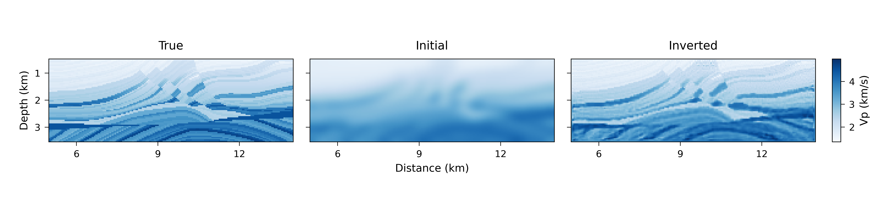
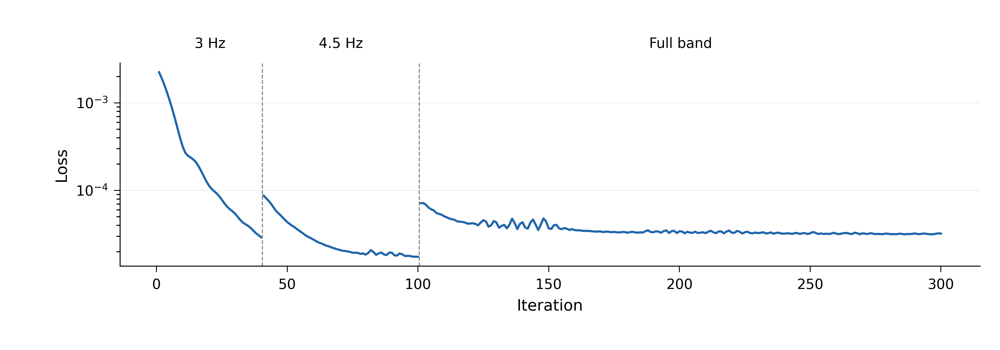

# DiffSPECFEM-native

**Authors** Xi Wang, Zhanwen Li, and Xin Liu (corresponding author)

Department of Earth and Planetary Sciences, The University of Hong Kong

We adapted SPECFEM2D with SeismicDiffSkill, a reusable Agent Skill that guides
a coding agent through solver adaptation and gradient verification. The resulting
DiffSPECFEM-native package runs independently. [SeismicDiffSkill](https://github.com/Wangxi404/differentiate-seismic-solver)
Forward and adjoint waves propagate in SPECFEM2D's native Fortran solver. PyTorch differentiates
the misfit with respect to the receiver traces to form the adjoint source.
SPECFEM2D then computes the Vp gradient.
To use a different misfit, implement its scalar PyTorch loss in
`Fast40Objective.tensor_loss` and adapt observation preparation in
`Fast40Objective.__init__` as needed. Set `objective.kind` to label the saved
run and figures. [Data objective](diffspecfem/objective.py) · [Configuration](examples/marmousi2/config.json)

## Marmousi-II inversion

The example uses 2D elastic P–SV waves, float64 propagation and debiased
soft-DTW divergence. Each update uses all 40 shots and 200 receivers to recover
Vp with Vs and density fixed. We use **the University of Houston AGL download
edition of Marmousi-II** for both the paper and this example. The starting
model is a 180 m Gaussian blur of Vp on a 68 × 200 grid.
The mesh under-resolves shear waves in some low-Vs regions.
[AGL source](https://www.agl.uh.edu/downloads/downloads.htm) · [Model paper](https://doi.org/10.1190/1.2172306)



*True Vp, initial Vp and inverted Vp after 300 updates share the same velocity scale. Marmousi-II model by Gary S. Martin, Robert Wiley and Kurt J. Marfurt (University of Houston AGL).*



## Run the example

Run these commands from the repository root on Ubuntu with Python 3.10–3.12.

```bash
sudo apt-get install git make gcc gfortran openmpi-bin libopenmpi-dev python3-venv
python3 -m venv .venv
source .venv/bin/activate
python -m pip install -r requirements.txt
python scripts/build_specfem.py --jobs 8
python scripts/invert_marmousi.py --workers 8 --device cpu
```

With CUDA-enabled PyTorch and a CUDA toolkit for Numba, use `--device cuda:0`
to run the misfit on the GPU. SPECFEM2D runs on the CPU in both cases.
Each run writes a local report to `runs/marmousi2/model-recovery.html` with
the true, initial and inverted Vp models side by side and the loss history.
To regenerate it from your saved run, use `python scripts/plot_results.py --run runs/marmousi2`.

On first use, the inversion downloads AGL's three Model Definition files,
checks their SHA-256 hashes and downsamples them to the paper grid. If the AGL
server is unavailable or returns different bytes, the downloader checks a
Wayback Machine snapshot of each original URL against the same hash. Subsequent
runs use the verified local cache. Set `MARMOUSI2_AGL_CACHE` to choose its
location. To prepare the cache before a run, including on a machine with
existing downloads, use one of these commands.

```bash
python scripts/prepare_marmousi_inputs.py
python scripts/prepare_marmousi_inputs.py --source-dir /path/to/agl/files
```

[Model data terms](assets/marmousi2d/DATA_TERMS.txt) · [Code licence](LICENSE)
